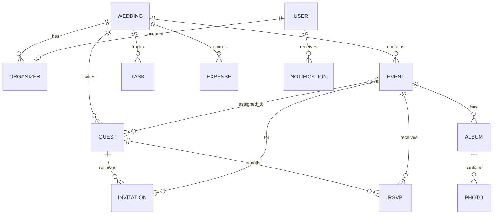

# Make My Marriage --- Database Architecture

**Document status:** MVP implementation baseline\
**Version:** 1.0\
**Database:** MongoDB Atlas\
**Media object storage:** Cloudflare R2\
**Backend access:** Spring Data MongoDB

## 1. Architecture principles

Make My Marriage is an application for exactly one wedding/marriage in
V1. The database design must reflect this constraint rather than
introducing a multi-tenant SaaS model prematurely.

Non-negotiable V1 constraints: - Exactly one wedding record per deployed
application environment. - No multi-wedding support, no tenant/workspace
collection, and no user-to-many-weddings membership model. - A user
cannot belong to multiple weddings. - No subscription, billing,
payment-plan or subscription collection in V1. Those are Version 2. -
MongoDB Atlas stores application data and metadata. - Cloudflare R2
stores photo objects. Do not store image binaries in MongoDB. - Angular
communicates with Java Spring Boot APIs; the backend is the only
component with database and R2 credentials.

## 2. Logical data model



This diagram describes logical relationships. MongoDB documents may
embed small value objects and use references for independently queried
or growing collections.

## 3. Collections

### 3.1 `wedding`

Exactly one document is allowed in the active environment.

Example:

``` json
{
  "_id": "ObjectId",
  "title": "Aarav & Ananya Wedding",
  "brideName": "Ananya Sharma",
  "groomName": "Aarav Sharma",
  "weddingDate": "2027-02-14",
  "timezone": "Asia/Kolkata",
  "venue": {
    "name": "Example Lawns",
    "address": "Pune, Maharashtra",
    "latitude": null,
    "longitude": null
  },
  "primaryLanguage": "en",
  "enabledLanguages": ["en", "hi", "mr"],
  "website": {
    "slug": "aarav-ananya",
    "published": false,
    "visibility": "PUBLIC"
  },
  "setupCompleted": true,
  "createdAt": "ISODate",
  "updatedAt": "ISODate"
}
```

Rules: - Enforce one active wedding at the application/service level and
with a unique singleton key, e.g. `scope: "PRIMARY_WEDDING"` with a
unique index. - Setup endpoint must fail with
`409 WEDDING_ALREADY_CONFIGURED` if the singleton already exists. - Do
not add a tenant ID or multiple-wedding array. - Do not delete the
primary wedding through ordinary user-facing APIs.

### 3.2 `users`

Organizer account identity and authentication details.

``` json
{
  "_id": "ObjectId",
  "fullName": "Aarav Sharma",
  "email": "aarav@example.com",
  "emailNormalized": "aarav@example.com",
  "phone": "+919876543210",
  "passwordHash": "<hash>",
  "status": "ACTIVE",
  "preferredLanguage": "en",
  "emailVerified": true,
  "createdAt": "ISODate",
  "updatedAt": "ISODate",
  "lastLoginAt": "ISODate"
}
```

Do not store plaintext passwords or refresh tokens in readable form.
Store normalized email for unique lookup. Do not include a list of
wedding IDs; a user has at most one organizer identity in this
single-wedding product.

### 3.3 `organizers`

Connects an account to the one wedding and assigns role/permissions.

``` json
{
  "_id": "ObjectId",
  "userId": "ObjectId",
  "displayName": "Priya Sharma",
  "role": "FAMILY_ORGANIZER",
  "permissions": [
    "EVENTS_READ",
    "EVENTS_WRITE",
    "GUESTS_READ",
    "GUESTS_WRITE",
    "RSVP_READ"
  ],
  "status": "ACTIVE",
  "invitedByUserId": "ObjectId",
  "acceptedAt": "ISODate",
  "createdAt": "ISODate",
  "updatedAt": "ISODate"
}
```

Suggested roles: - `COUPLE_OWNER` - `COUPLE_CO_ORGANIZER` -
`FAMILY_ORGANIZER`

Use explicit permissions for family organizers. The owner has full
authority. Enforce unique `userId` so an account cannot be attached to
multiple organizer records.

### 3.4 `organizer_invitations`

``` json
{
  "_id": "ObjectId",
  "name": "Priya Sharma",
  "emailNormalized": "priya@example.com",
  "tokenHash": "<hashed-token>",
  "permissions": ["EVENTS_READ", "GUESTS_READ"],
  "status": "PENDING",
  "expiresAt": "ISODate",
  "invitedByUserId": "ObjectId",
  "acceptedByUserId": null,
  "createdAt": "ISODate",
  "acceptedAt": null
}
```

Use TTL index on `expiresAt` only if expired invitation records can
safely be deleted; otherwise retain them for audit and use a scheduled
cleanup policy.

### 3.5 `events`

``` json
{
  "_id": "ObjectId",
  "name": "Haldi Ceremony",
  "description": "Haldi celebration",
  "eventType": "HALDI",
  "startAt": "ISODate",
  "endAt": "ISODate",
  "timezone": "Asia/Kolkata",
  "venue": {
    "name": "Family Residence",
    "address": "Pune, Maharashtra"
  },
  "visibility": "INVITED_GUESTS",
  "status": "ACTIVE",
  "createdBy": "ObjectId",
  "createdAt": "ISODate",
  "updatedAt": "ISODate"
}
```

Events are top-level documents because they are independently listed,
edited, and filtered. They belong to the single wedding implicitly; no
tenant or wedding-switching abstraction is required.

### 3.6 `guests`

``` json
{
  "_id": "ObjectId",
  "fullName": "Meera Patil",
  "email": "meera@example.com",
  "emailNormalized": "meera@example.com",
  "phone": "+919876543210",
  "familyGroup": "Bride Family",
  "preferredLanguage": "mr",
  "notes": "Optional organizer-only note",
  "eventIds": ["ObjectId"],
  "status": "ACTIVE",
  "createdBy": "ObjectId",
  "createdAt": "ISODate",
  "updatedAt": "ISODate"
}
```

Notes: - Guest is not automatically an organizer user. - Guest access is
via invitation token and/or OTP. - `eventIds` is acceptable for the
initial MVP if the number of events per wedding remains small. For very
large event/guest assignments, introduce a separate
`event_guest_assignments` collection. - Do not expose private notes
through guest APIs.

### 3.7 `invitations`

One invitation record per guest/event/channel or per guest/event with
channel delivery attempts stored separately. Choose one consistent
model; recommended: one guest-event invitation document with delivery
metadata.

``` json
{
  "_id": "ObjectId",
  "guestId": "ObjectId",
  "eventId": "ObjectId",
  "invitationTokenHash": "<hashed-token>",
  "status": "SENT",
  "channels": ["EMAIL"],
  "sentAt": "ISODate",
  "expiresAt": "ISODate",
  "delivery": [
    {
      "channel": "EMAIL",
      "status": "DELIVERED",
      "providerMessageId": "provider-id",
      "attemptedAt": "ISODate"
    }
  ],
  "createdBy": "ObjectId",
  "createdAt": "ISODate",
  "updatedAt": "ISODate"
}
```

Avoid storing raw long-lived invitation tokens. If the system needs to
reproduce a guest link, issue a new token rather than recovering an old
plaintext token.

### 3.8 `guest_access_sessions` and `otp_challenges`

Guest sessions and OTP challenges should be short-lived and protected.

`otp_challenges` example:

``` json
{
  "_id": "ObjectId",
  "guestId": "ObjectId",
  "invitationId": "ObjectId",
  "destinationHash": "<hash>",
  "otpHash": "<hash>",
  "attemptCount": 0,
  "expiresAt": "ISODate",
  "consumedAt": null,
  "createdAt": "ISODate"
}
```

`guest_access_sessions` may store hashed refresh/session token, guest
ID, expiry and revocation time. Apply TTL indexes to ephemeral records
when appropriate. Never log OTPs.

### 3.9 `rsvps`

``` json
{
  "_id": "ObjectId",
  "guestId": "ObjectId",
  "eventId": "ObjectId",
  "status": "ACCEPTED",
  "attendeeCount": 2,
  "message": "Looking forward to it",
  "respondedAt": "ISODate",
  "updatedAt": "ISODate"
}
```

Create a unique compound index on `{ guestId: 1, eventId: 1 }` so each
guest has one current RSVP per event. If RSVP history is needed, add an
audit/event history rather than duplicate active records.

### 3.10 `albums`

``` json
{
  "_id": "ObjectId",
  "eventId": "ObjectId",
  "name": "Haldi Highlights",
  "description": "Photos from the Haldi ceremony",
  "visibility": "INVITED_GUESTS",
  "status": "ACTIVE",
  "createdBy": "ObjectId",
  "createdAt": "ISODate",
  "updatedAt": "ISODate"
}
```

An album belongs to one event. Visibility must be checked against guest
event assignment and album policy.

### 3.11 `photos`

``` json
{
  "_id": "ObjectId",
  "albumId": "ObjectId",
  "eventId": "ObjectId",
  "objectKey": "wedding/events/<eventId>/<albumId>/<random-id>.jpg",
  "thumbnailObjectKey": null,
  "originalFileName": "haldi-001.jpg",
  "contentType": "image/jpeg",
  "sizeBytes": 2457600,
  "width": null,
  "height": null,
  "uploadStatus": "AVAILABLE",
  "uploadedBy": "ObjectId",
  "createdAt": "ISODate",
  "updatedAt": "ISODate"
}
```

Store only metadata and R2 object keys in MongoDB. Do not store signed
URLs because they expire. Generate signed URLs after authorization.
Never accept arbitrary object keys from a guest as proof of access.

V1 photo behavior is event-wise albums and shared permitted galleries.
AI face recognition, automatic guest-specific photo discovery and face
embeddings are excluded.

### 3.12 `tasks`

``` json
{
  "_id": "ObjectId",
  "title": "Finalize invitation design",
  "description": "Approve invitation artwork",
  "assigneeOrganizerId": "ObjectId",
  "dueDate": "2027-01-10",
  "priority": "HIGH",
  "status": "TODO",
  "createdBy": "ObjectId",
  "createdAt": "ISODate",
  "updatedAt": "ISODate",
  "completedAt": null
}
```

### 3.13 `expenses`

``` json
{
  "_id": "ObjectId",
  "title": "Venue advance",
  "category": "VENUE",
  "amount": 50000,
  "currency": "INR",
  "expenseDate": "2026-11-01",
  "paymentStatus": "PAID",
  "paidBy": "Aarav",
  "notes": "Advance paid to venue",
  "createdBy": "ObjectId",
  "createdAt": "ISODate",
  "updatedAt": "ISODate"
}
```

Use Decimal128 or integer minor units (paise) for reliable monetary
arithmetic. Pick one representation consistently. `paymentStatus` is
bookkeeping only; this collection is not a payment gateway ledger.

### 3.14 `website_settings`

``` json
{
  "_id": "ObjectId",
  "slug": "aarav-ananya",
  "published": false,
  "theme": "DEFAULT",
  "welcomeText": {
    "en": "Join us to celebrate",
    "hi": "",
    "mr": ""
  },
  "publicSections": ["COUPLE", "EVENTS", "VENUE"],
  "updatedBy": "ObjectId",
  "updatedAt": "ISODate"
}
```

Public website reads must return only explicitly published fields. Never
include guest PII or internal organizer data.

### 3.15 `livestreams`

``` json
{
  "_id": "ObjectId",
  "eventId": "ObjectId",
  "provider": "YOUTUBE",
  "url": "https://www.youtube.com/live/example",
  "visibility": "INVITED_GUESTS",
  "startsAt": "ISODate",
  "status": "ACTIVE",
  "updatedBy": "ObjectId",
  "updatedAt": "ISODate"
}
```

This stores an external link only. No video content or stream
credentials should be stored.

### 3.16 `notifications` and `notification_outbox`

`notifications` stores in-app notification records.
`notification_outbox` stores pending email/SMS delivery work for
reliable retries.

Notification:

``` json
{
  "_id": "ObjectId",
  "recipientUserId": "ObjectId",
  "recipientGuestId": null,
  "type": "RSVP_UPDATED",
  "title": "RSVP received",
  "message": "A guest responded to an event",
  "readAt": null,
  "createdAt": "ISODate"
}
```

Outbox:

``` json
{
  "_id": "ObjectId",
  "eventType": "INVITATION_EMAIL",
  "aggregateId": "ObjectId",
  "payload": {},
  "status": "PENDING",
  "attemptCount": 0,
  "nextAttemptAt": "ISODate",
  "createdAt": "ISODate",
  "sentAt": null
}
```

Do not store unnecessary copies of sensitive guest information in
message payloads.

### 3.17 `audit_logs`

Record security-sensitive actions such as organizer permission changes,
guest record updates, invitation sending, expense changes, website
publishing and photo deletion.

``` json
{
  "_id": "ObjectId",
  "actorUserId": "ObjectId",
  "action": "ORGANIZER_PERMISSION_UPDATED",
  "resourceType": "ORGANIZER",
  "resourceId": "ObjectId",
  "metadata": {
    "changedPermissionCount": 2
  },
  "createdAt": "ISODate"
}
```

Do not put passwords, OTPs, access tokens, full invitation tokens or
secret URLs in audit metadata.

## 4. Index strategy

Create indexes based on actual query patterns and verify them with
MongoDB explain plans.

  -----------------------------------------------------------------------------------------------------
  Collection              Index                                                 Purpose
  ----------------------- ----------------------------------------------------- -----------------------
  `wedding`               unique `{ scope: 1 }`                                 Enforce singleton
                                                                                wedding

  `users`                 unique `{ emailNormalized: 1 }`                       Login lookup

  `organizers`            unique `{ userId: 1 }`                                One organizer
                                                                                membership per user

  `organizers`            `{ status: 1, role: 1 }`                              Active organizer
                                                                                listing

  `events`                `{ startAt: 1 }`                                      Event timeline

  `guests`                `{ fullName: 1 }`                                     Guest search

  `guests`                `{ emailNormalized: 1 }` sparse/partial               Duplicate lookup where
                                                                                email exists

  `guests`                `{ phone: 1 }` sparse/partial                         Phone lookup

  `invitations`           unique `{ guestId: 1, eventId: 1 }`                   One invitation per
                                                                                guest/event

  `invitations`           `{ status: 1, createdAt: -1 }`                        Invitation reporting

  `rsvps`                 unique `{ guestId: 1, eventId: 1 }`                   One RSVP per
                                                                                guest/event

  `rsvps`                 `{ eventId: 1, status: 1 }`                           Event RSVP summaries

  `albums`                `{ eventId: 1, status: 1 }`                           Event albums

  `photos`                `{ albumId: 1, createdAt: -1 }`                       Album pagination

  `photos`                `{ eventId: 1, createdAt: -1 }`                       Event gallery

  `tasks`                 `{ status: 1, dueDate: 1 }`                           Task dashboard

  `tasks`                 `{ assigneeOrganizerId: 1, status: 1 }`               Organizer tasks

  `expenses`              `{ expenseDate: -1 }`                                 Expense listing

  `expenses`              `{ category: 1, expenseDate: -1 }`                    Expense summaries

  `website_settings`      unique `{ slug: 1 }`                                  Public website route

  `livestreams`           unique `{ eventId: 1 }`                               One stream
                                                                                configuration per event

  `notifications`         `{ recipientUserId: 1, createdAt: -1 }`               User inbox

  `notification_outbox`   `{ status: 1, nextAttemptAt: 1 }`                     Delivery worker

  `audit_logs`            `{ resourceType: 1, resourceId: 1, createdAt: -1 }`   Audit history
  -----------------------------------------------------------------------------------------------------

Use TTL indexes for expiring OTP challenges, temporary sessions and
short-lived upload reservations. TTL deletion is asynchronous;
application logic must still check expiry timestamps.

## 5. Relationships and consistency

MongoDB does not provide relational foreign keys. The service layer must
validate references: - An RSVP's guest and event must exist. - A guest
can RSVP only to an assigned event. - An invitation must reference an
existing guest and event. - An album must reference an existing event. -
A photo must reference an existing album and event. - A task assignee
must be an active organizer. - A livestream must reference an existing
event.

Use MongoDB transactions for operations that need atomic updates across
multiple documents and only where the Atlas deployment
tier/configuration supports transactions. Otherwise use idempotent
workflows and compensating actions.

## 6. Singleton wedding enforcement

Recommended approach: 1. Store a fixed `scope: "PRIMARY_WEDDING"` field
on the wedding document. 2. Create a unique index on `scope`. 3.
Implement setup as an atomic insert. 4. Return conflict if a wedding
already exists. 5. Never expose a generic `/weddings` collection API or
wedding selector.

This gives the application exactly one wedding without introducing
tenant abstractions.

## 7. Cloudflare R2 storage architecture

MongoDB stores object metadata; R2 stores bytes.

Suggested object key:

``` text
wedding/
  events/
    <event-id>/
      albums/
        <album-id>/
          <random-uuid>.jpg
          thumbnails/
            <random-uuid>.webp
```

Recommended upload lifecycle: 1. Angular asks Spring Boot for an upload
reservation. 2. Spring Boot checks organizer permission and file
constraints. 3. Spring Boot creates a random object key and returns a
short-lived signed upload URL. 4. Browser uploads directly to R2. 5.
Browser calls completion endpoint. 6. Backend verifies object metadata
and writes the photo document. 7. Background worker generates thumbnails
if enabled. 8. API creates short-lived signed read URLs only after
checking access.

Never put R2 access keys in frontend code. Configure lifecycle rules
only after agreeing on retention and deletion policy. Back up MongoDB
metadata and define a separate object-storage recovery strategy.

## 8. Data lifecycle and privacy

-   Keep guest contact information private and visible only to
    authorized organizers.
-   Guest APIs return only that guest's own invitation/RSVP and
    permitted event/gallery content.
-   Provide a defined process for correcting or deleting guest data.
-   Revoke guest sessions when invitation access is revoked.
-   Remove orphaned R2 objects through a scheduled reconciliation
    process.
-   Define whether archived records are retained for audit and for how
    long.
-   Collect only data needed for wedding coordination.
-   Use encryption in transit and managed encryption at rest.
-   Restrict database network access and credentials to the backend
    service.

## 9. Collections explicitly excluded from V1

Do not create: - `tenants`, `workspaces`, `weddings` as a multi-record
tenant collection, or `user_weddings`. - `plans`, `subscriptions`,
`invoices`, `billing_accounts`, or subscription payment collections. -
Vendor portal collections. - Seating assignment/optimization
collections. - Travel or accommodation booking collections. - Face
embeddings, face matches, AI recognition jobs or guest-specific
face-group collections.

Version 2 may revisit subscription/billing after a separate product and
architecture decision.

## 10. Implementation checklist

-   [ ] Define Java domain models and MongoDB document classes.
-   [ ] Add schema validation at API/service level.
-   [ ] Create indexes through versioned startup migration scripts or
    controlled deployment jobs.
-   [ ] Implement singleton wedding creation and conflict handling.
-   [ ] Implement organizer permission checks.
-   [ ] Implement guest/event assignment validation.
-   [ ] Implement R2 signed upload/download flows.
-   [ ] Implement TTL and cleanup policies.
-   [ ] Add repository and integration tests for unique constraints and
    reference integrity.
-   [ ] Document backup, restore and retention procedures.
